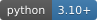
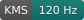
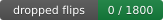
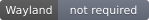
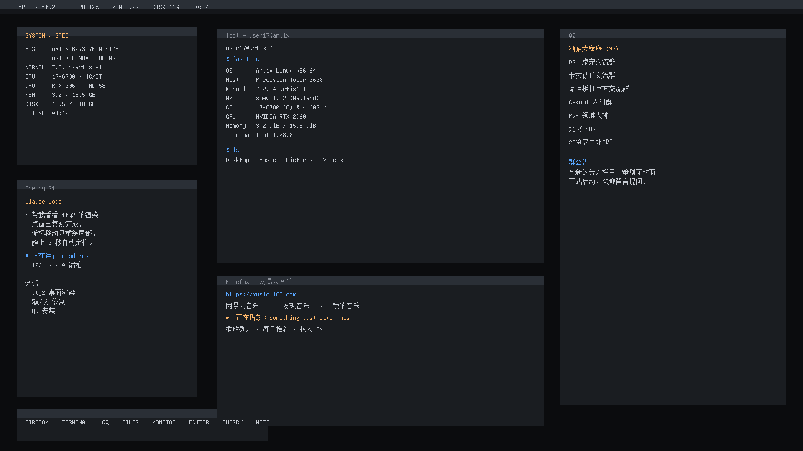
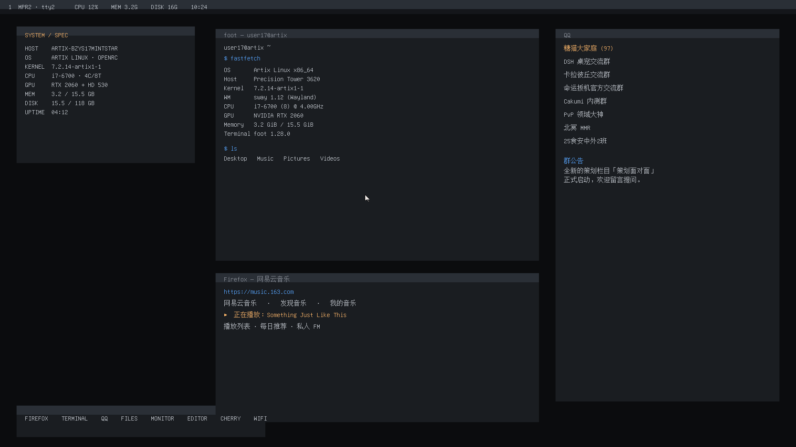
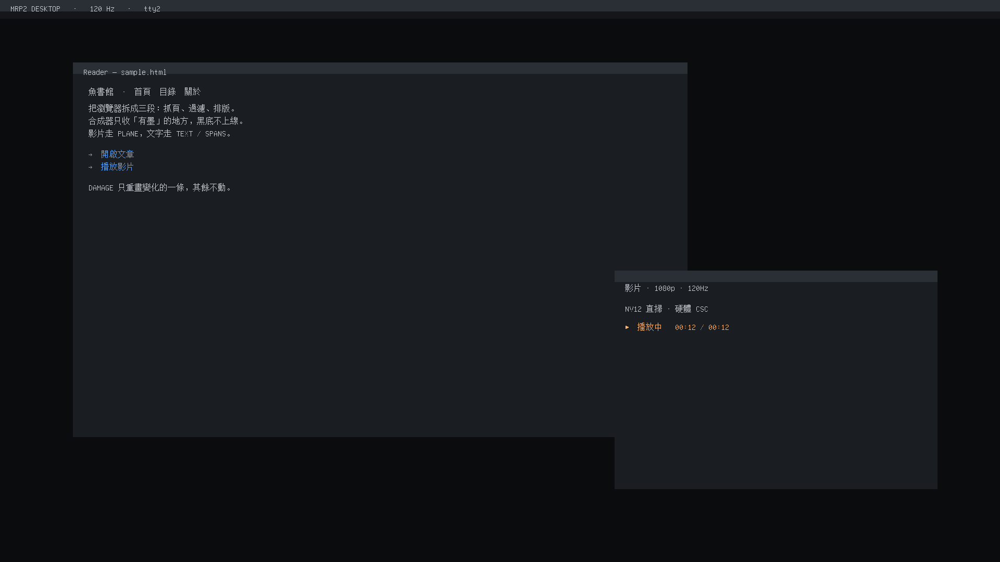

<p align="center">
  
</p>

<p align="right"><b>English</b> · <a href="./README.zh-CN.md">简体中文</a></p>

> [!CAUTION]
> **Non-commercial use only. Commercial use is not licensed.**
> **禁止商用。**
>
> Personal, research, educational, and non-profit use are fine. If you want to use
> this commercially, you need a separate license — see [License](#license).

# MRP2

**Putting 120 Hz straight into KMS.**

<p align="center">
  
  
  
  
  
  
  
  
</p>

No Wayland. No X. No desktop compositor. A userspace process grabs DRM master,
computes its own damage rectangles, moves its own pixels, and page-flips them to the panel.

Measured on an RTX 2060: **119.9 fps, 1800 frames, zero dropped flips.**

```text
ffmpeg decodes H.264 → NV12
        ↓  GBM dmabuf, zero copy
3 × NV12 scanout buffers (seq/ack, depth 3)
        ↓
primary plane page flip (120 Hz, hardware CSC)
        ↓
UI on an overlay plane (SetPlane once, then only mapped memory is touched)
```

---

## What it is

A **system-level rendering protocol**, not a Wayland client protocol.

```text
HELLO / SURF / SPANS / TEXT / PLANE / BUFFER / DAMAGE / COMMIT / UNMAP / FRAME
```

`plan()` turns dirty regions into ops; `raster()` composites 1-bit glyphs and
flat rectangles with the painter's algorithm. Fonts use a hand-rolled MRPF container:
`'MRPF' | ver u16 | count u32 | data_off u32` (14-byte header).

It does not fit inside a sway workspace — real KMS scanout needs its own VT (`tty2`)
or a second GPU. The `ladder/` directory uses `tty2` as a canvas and reconstructs
an entire desktop on it.

## Thirteen stages, from 59 fps to zero drops

| Stage | What was done | Result |
|---|---|---|
| 1 | Offscreen protocol / raster / composite benchmark | C 0.10 ms vs Python 9.09 ms (**~91×**) |
| 2 | KMS bring-up | static 120.6 fps; per-pixel 59.1 fps |
| 3 | Precomputed background + memcpy | 120.0 fps, 2.002 ms/frame |
| 4 | DAMAGE narrow-band repaint | **0.171 ms/frame**, 360 KB per frame |
| 5 | Triple buffering + FLIP_COMPLETE | 1800 frames at 119.9 fps, **0 dropped** |
| 6 | Protocol → KMS integration | 0.252 ms/frame; full-screen 6.089 ms, **24×** saved |
| 7 | PLANE shared-memory video | 119.9 fps, 4.74 ms/frame |
| 8 | Zero-copy scanout (GBM dmabuf) | compositor **0.000 ms**, 120.0 fps |
| 9 | NV12 hardware decode direct scanout | fill 1.07 ms, 120.1 fps, 3.1 MB/frame |
| 10 | Real ffmpeg content | 119.9 fps, 450 video frames, 0 drops |
| 11 | A/V + UI + Bilibili | local A/V at 119.9 fps |
| 12 | Desktop scene rendering | 3 mrpd bugs fixed; 119.9 fps, 0.571 ms/frame |
| 13 | tty2 desktop replica + damage freeze | 1440 updates / 23 s, **0.017 ms each**, 0.027% dirty |

Full numbers in [`docs/实测数据.md`](docs/实测数据.md); raw output under `ladder/out/`.

## What it looks like

| Preview | Notes |
|---|---|
|  | A desktop reconstructed on tty2: top bar / SYSTEM panel / dock / terminal / browser / QQ |
|  | Cursor movement repaints only two 14×20 rectangles |
|  | Dark scene |

## Run it

```bash
# regular scene: 1800 frames @ 120 Hz
sudo ./ladder/run-safe.sh 30 ./ladder/bin/mrpd_kms \
  ./ladder/assets/tty2desktop.wire 1800 120 \
  --font ./ladder/assets/font16.rom

# tty2 desktop replica: real mouse, 2 minutes
sudo ./ladder/tty2-desktop.sh mouse 120

# scripted demo: activity 0-6s and 11-17s, still the rest of the time
sudo ./ladder/tty2-desktop.sh scripted 23
```

> Binaries are x86-64 Linux. All C sources are in `ladder/src/`; rebuild with `./ladder/run.sh`.

## One rule, paid for with a reboot

During a stress test, `nv12_ui` was SIGKILLed while still holding DRM master.
The CRTC stayed on its buffer, sway lost its output after switching back to tty1,
and the machine had to be rebooted.

Since then, **anything that touches `/dev/dri` must go through `run-safe.sh`**:

1. `setsid` process group with a hard watchdog timeout
2. SIGTERM first; if needed, `chvt 1` **before** SIGKILL
3. Never SIGKILL a process holding DRM master
4. After exit, poll until `active=true` at 119.88 Hz; auto-recover if not

## A note on NVIDIA

This project exists because a machine with an RTX 2060 was sitting there and could do
120 Hz. That is the whole endorsement.

While writing a renderer that talks to KMS directly, the proprietary driver made us
solve three riddles. All three are reproducible, and all three are documented in
`ladder/` rather than in a support ticket:

| What we asked for | What we got | Workaround |
|---|---|---|
| RW `mmap` on a PRIME-exported dumb buffer | `EACCES` — read-only mapping only | allocate through GBM instead |
| `gbm_bo_map` on an NV12 buffer | `ENOSYS` | `mmap` the dmabuf fd directly |
| a clean exit after a crashed DRM master | CRTC parked on a dead buffer, `sway` output gone, reboot | `run-safe.sh`, and never SIGKILL a DRM master holder |

To be fair: the third one is our bug, not theirs — we killed the process. The first two
are just the shape of the API, and once you know the shape, 120 Hz works fine.

None of this is a benchmark of NVIDIA's engineering, and it is not a verdict on the
driver. It is a list of walls we hit, published so the next person doesn't hit them too.

**NVIDIA has not endorsed, sponsored, or reviewed this project.**
"NVIDIA", "RTX", and "GeForce" are trademarks of NVIDIA Corporation, used here only to
describe the hardware this was tested on. No affiliation is claimed or implied.

If you work at NVIDIA and these notes are wrong, open an issue with the fix — being
correct is more useful to us than being annoyed.

### FAQ

**Q: Is this an NVIDIA project?**
A: No.

**Q: Did NVIDIA help?**
A: Not on purpose. The driver did teach us two error codes, though.

**Q: Does it work on NVIDIA hardware?**
A: Yes — 119.9 fps, 1800 frames, zero dropped flips. We were as surprised as you are.

**Q: Why not CUDA?**
A: We don't need compute. We need pixels on a panel at 120 Hz, and KMS does not care
whose logo is on the card.

**Q: Any message for NVIDIA?**
A: Two, actually. The `EACCES` and the `ENOSYS` are both avoidable. Fix them and this
section disappears; until then it stays, with receipts.

### Hall of EACCES

Everything below is reproducible on the test machine (kernel `7.2.14-artix1-1`,
proprietary driver, 2026-11-10). No interpretation, just return values.

| Call | Returned | Documented in |
|---|---|---|
| `mmap(PROT_READ\|PROT_WRITE)` on a PRIME-exported dumb buffer | `EACCES` | stage 8 |
| `gbm_bo_map()` on an NV12 buffer | `ENOSYS` | stage 9 |
| `mmap()` on the dmabuf fd instead | works | stage 9 |

The third row is the punchline: the buffer was writable all along, just not through
the front door.

## Known limits

- No borders, shadows, rounded corners, or alpha gradients; a window is a flat
  rectangle with a 22 px title bar
- Not usable as a sway client protocol; real KMS needs a separate VT or GPU
- Bilibili's mcdn streams hang forever on tty2; download with a bound, then play locally
- Stage 13's "release the mouse, freeze for 3 s" was never fully verified on hardware
  (a PAM lockout interrupted it)

## Layout

```text
protocol/   MRP2 protocol and reference implementations (Python + C)
ladder/     stages 1–13: code, scripts, assets, raw results
previews/   1920×1080 render previews
docs/       measured data, delivery notes
assets/     the non-commercial banner and the badges used by this README
```

## Checksums

Delivery tarball SHA-256:

```text
b700b47b7a352ab44954bd2b563512c1a44c3baed8e6f65ecce1056ddc7b2fc7
mrp2-delivery-2026-11-10.tar.gz
```

Per-file checksums are in [`SHA256SUMS`](SHA256SUMS).

## License

[PolyForm Noncommercial 1.0.0](https://polyformproject.org/licenses/noncommercial/1.0.0).

**Allowed:** personal study, research, experiments, hobby projects; use by charities,
schools, public research bodies, public health/safety organizations, environmental
groups, and government institutions.

**Not allowed:** any commercial use — including internal use inside a company,
embedding it in a commercial product, or using it to deliver a paid service.

Commercial licensing: open an issue or contact the maintainer.

One honest note: this is **not an OSI open-source license**. The source is public,
but commercial use is prohibited. If you need an OSI-approved license instead,
AGPLv3 is the closest thing that still discourages free-riding.
