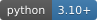
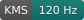
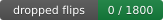
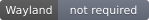
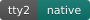
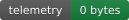
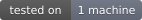
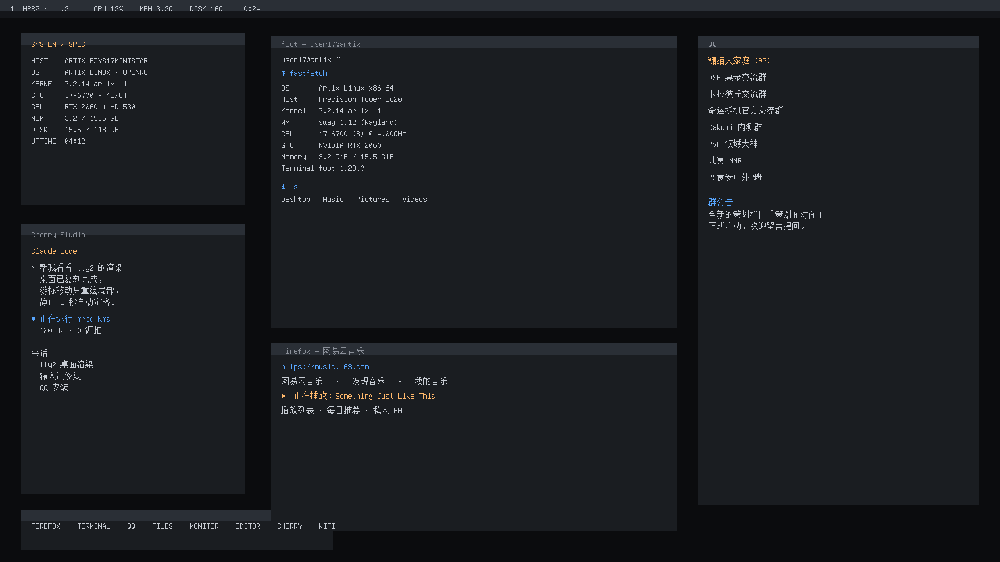
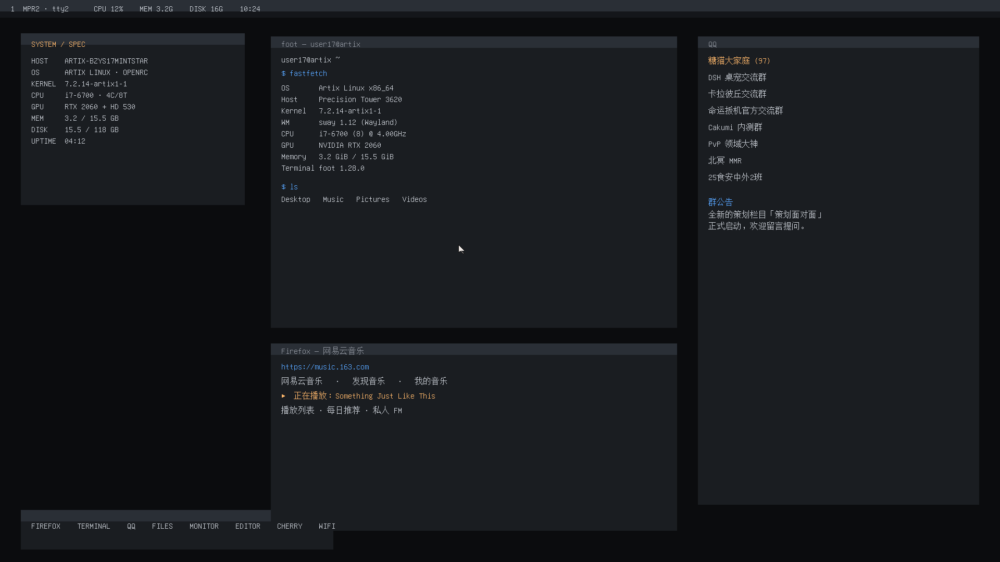
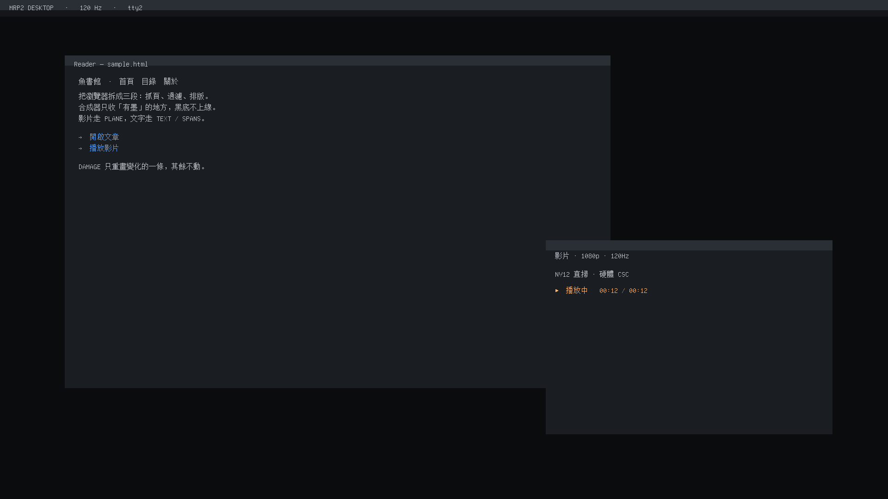

<p align="center">
  
</p>

<p align="right"><a href="./README.md">English</a> · <b>简体中文</b></p>

> [!CAUTION]
> **禁止商用。商用需要单独授权。**
> **Non-commercial use only.**
>
> 个人学习、研究、教育、非营利组织使用都可以。要商用请先取得授权——见文末 [License](#license)。

# MRP2

**把 120 Hz 直接写进 KMS。**

<p align="center">
  
  
  
  
  
  
  
  
  
  
  
  
  
  
</p>

不经过 Wayland、不经过 X、不经过桌面合成器——一个用户态进程拿 DRM master，
自己算脏区、自己搬像素、自己 page flip 到屏幕。

在 RTX 2060 上跑出来的数字：**119.9 fps，1800 帧，0 漏拍。**

```text
ffmpeg 解码 H.264 → NV12
        ↓  GBM dmabuf，零拷贝
3 × NV12 扫描缓冲（seq/ack 3 深度握手）
        ↓
主平面 page flip（120 Hz，硬件 CSC）
        ↓
UI 走 overlay plane（SetPlane 一次，之后只改映射内存）
```

---

## 它是什么

一个**系统级渲染协议**，不是 Wayland 客户端协议。

```text
HELLO / SURF / SPANS / TEXT / PLANE / BUFFER / DAMAGE / COMMIT / UNMAP / FRAME
```

`plan()` 按脏区生成 ops，`raster()` 用画家算法合成 1bpp 字形 + 平色矩形。
字模是自研 MRPF：`'MRPF' | ver u16 | count u32 | data_off u32`（14 字节头）。

它不能塞进 sway 的工作区——真实 KMS 输出需要独立 VT（tty2）或者第二块 GPU。
仓库里的 `ladder/` 就是拿 tty2 当画布，硬复刻了一个桌面出来。

## 13 个阶段，从 59 fps 到 0 漏拍

| 阶段 | 干了什么 | 结果 |
|---|---|---|
| 1 | 离屏协议 / 光栅 / 合成基准 | C 0.10 ms vs Python 9.09 ms（**~91×**） |
| 2 | KMS 打通 | 静态 120.6 fps；逐像素 59.1 fps |
| 3 | 背景预计算 + memcpy | 120.0 fps，2.002 ms/帧 |
| 4 | DAMAGE 窄带 | **0.171 ms/帧**，每帧只搬 360 KB |
| 5 | 三缓冲 + FLIP_COMPLETE | 1800 帧 119.9 fps，**漏拍 0** |
| 6 | 协议 → KMS 整合 | 脏区 0.252 ms/帧；整屏 6.089 ms，省 **24×** |
| 7 | PLANE 共享内存视频 | 119.9 fps，4.74 ms/帧 |
| 8 | 零拷贝直扫（GBM dmabuf） | 合成器 **0.000 ms**，120.0 fps |
| 9 | NV12 硬解直扫 | 填充 1.07 ms，120.1 fps，每帧 3.1 MB |
| 10 | ffmpeg 真内容 | 119.9 fps，450 视频帧，0 漏拍 |
| 11 | A/V + UI + B 站 | 本地 119.9 fps |
| 12 | 桌面场景渲染 | 修 3 个 mrpd bug；119.9 fps，0.571 ms/帧 |
| 13 | tty2 桌面复刻 + 脏区定格 | 1440 次更新 / 23 s，**0.017 ms/次**，脏区 0.027% |

完整数据在 [`docs/实测数据.md`](docs/实测数据.md)，原始输出在 `ladder/out/`。

## 看看它长什么样

| 预览 | 说明 |
|---|---|
|  | tty2 上硬复刻的桌面：顶栏 / SYSTEM 面板 / dock / 终端 / 浏览器 / QQ |
|  | 鼠标移动：只还原 + 重画两个 14×20 小矩形 |
|  | 暗色场景 |

## 跑起来

```bash
# 普通场景：1800 帧 @ 120 Hz
sudo ./ladder/run-safe.sh 30 ./ladder/bin/mrpd_kms \
  ./ladder/assets/tty2desktop.wire 1800 120 \
  --font ./ladder/assets/font16.rom

# tty2 桌面复刻：真实鼠标，2 分钟
sudo ./ladder/tty2-desktop.sh mouse 120

# 自动示范：0-6s / 11-17s 活动，其余静止
sudo ./ladder/tty2-desktop.sh scripted 23
```

> 二进制是 x86-64 Linux 的；`ladder/src/` 里有全部 C 源码，`./ladder/run.sh` 可重编。

## 一条用重启换来的规矩

有一次压测里，`nv12_ui` 被 SIGKILL 时还攥着 DRM master——CRTC 停在它的缓冲上，
切回 tty1 之后 sway 整个输出失效，只能重启。

所以现在**任何碰 `/dev/dri` 的东西都必须走 `run-safe.sh`**：

1. `setsid` 进程组，看门狗硬超时
2. 先 SIGTERM，必要时先 `chvt 1` 再 SIGKILL
3. **绝不**直接 SIGKILL 持有 DRM master 的进程
4. 结束轮询验证 `active=true` 且 119.88 Hz，不恢复就自动救

## 关于 NVIDIA

这个项目存在，是因为手边正好有台带 RTX 2060 的机器，而且它能跑 120 Hz。这就是全部的「背书」。

在写一个直接跟 KMS 打交道的渲染器时，专有驱动让我们解了三道谜题。三条都可复现，
而且都记在 `ladder/` 里，而不是记在工单里：

| 我们想要的 | 实际拿到的 | 绕法 |
|---|---|---|
| 对 PRIME 导出的 dumb buffer 做读写 `mmap` | `EACCES`，只给只读映射 | 改走 GBM 分配 |
| 对 NV12 buffer 调 `gbm_bo_map` | `ENOSYS` | 直接 `mmap` dmabuf fd |
| DRM master 崩了之后干净退出 | CRTC 停在死缓冲上，sway 输出消失，只能重启 | `run-safe.sh`，且绝不 SIGKILL 持有 DRM master 的进程 |

公道地说：第三条是我们的 bug，不是他们的——是我们把它杀了。前两条只是 API 的形状，
知道形状之后，120 Hz 跑得好好的。

这不是对 NVIDIA 工程能力的评测，也不是对驱动的判决。它只是一张「我们撞过的墙」的清单，
公开出来，下一个人别再撞一遍。

**NVIDIA 未对本项目背书、赞助或审阅。**
"NVIDIA"、"RTX"、"GeForce" 是 NVIDIA Corporation 的商标，此处仅用于说明测试所用硬件，
不声称也不暗示任何隶属关系。

如果你在 NVIDIA 工作、发现这些记录有误，欢迎开 issue 指正——对我们来说，
「你是对的」比「你生气了」有用。

### FAQ

**问：这是 NVIDIA 的项目吗？**
答：不是。

**问：NVIDIA 帮忙了吗？**
答：不是有意的。不过驱动确实教会了我们两个错误码。

**问：在 NVIDIA 硬件上能跑吗？**
答：能——119.9 fps，1800 帧，零漏拍。我们和你一样意外。

**问：为什么不用 CUDA？**
答：我们不需要算力。我们需要的是 120 Hz 的像素上屏，而 KMS 不在乎卡上印的是谁的标。

**问：有什么想对 NVIDIA 说的吗？**
答：两件。`EACCES` 和 `ENOSYS` 都是可以避免的。修掉，这一节就消失；
不修，它就留在这儿，带着证据。

### 错误码名人堂

以下全部可在测试机上复现（kernel `7.2.14-artix1-1`，专有驱动，2026-11-10）。
不做解读，只列返回值。

| 调用 | 返回 | 记录在 |
|---|---|---|
| 对 PRIME 导出的 dumb buffer 做 `mmap(PROT_READ\|PROT_WRITE)` | `EACCES` | 阶段 8 |
| 对 NV12 buffer 调 `gbm_bo_map()` | `ENOSYS` | 阶段 9 |
| 改成 `mmap()` dmabuf fd | 成功 | 阶段 9 |

第三行才是重点：缓冲一直是可写的，只是不让你走前门。

## 已知限制

- 协议没有边框、阴影、圆角、透明渐变；窗口 = 平色矩形 + 22px 标题条
- 不适合当 sway 的客户端协议；真 KMS 要独立 VT 或第二块 GPU
- B 站 mcdn 流在 tty2 会无限卡住，只能有界下载后本地播
- 阶段 13 的「鼠标松手 3 秒定格」整机验证没做完（调试时 PAM 锁了 10 分钟）

## 目录

```text
protocol/   MRP2 协议与参考实现（Python + C）
ladder/     阶段 1–13 的代码、脚本、资源、原始结果
previews/   渲染预览图（1920×1080）
docs/       实测数据汇总、交付说明
assets/     禁止商用横幅与徽章
```

## 校验

交付包 SHA-256：

```text
b700b47b7a352ab44954bd2b563512c1a44c3baed8e6f65ecce1056ddc7b2fc7
mrp2-delivery-2026-11-10.tar.gz
```

仓库内每个文件的校验和见 [`SHA256SUMS`](SHA256SUMS)。

## License

[PolyForm Noncommercial 1.0.0](https://polyformproject.org/licenses/noncommercial/1.0.0)。

**允许**：个人学习、研究、实验、业余项目；慈善机构、教育机构、公共研究机构、
公共安全/卫生机构、环保组织、政府机构使用（不论经费来源）。

**不允许**：任何商业目的的使用——包括在公司内部使用、集成进商业产品、
或用来提供收费服务。

商用授权：开 issue 或联系维护者。

一句实话：这**不是** OSI 认可的开源协议。源码公开，但商用被禁止。
如果你需要 OSI 认可的协议，AGPLv3 是最接近「仍然能劝退白嫖」的选择。
